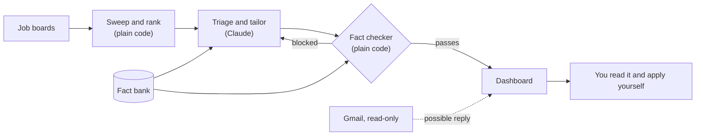

# War Room

**A job-search system where AI does the reading and drafting, and plain code decides whether a draft is allowed to exist.**

I built this for my own job search. Every morning it reads company job boards, ranks what it finds, tailors a resume and cover letter for the best matches, and has them waiting on a local dashboard. It never applies to anything: I read each draft and send it myself.

The interesting problem isn't generating a resume. It's that a language model will happily write a confident, plausible, false one. So the model isn't trusted to police itself. A deterministic fact checker stands between every draft and "ready to send", and it can't be talked out of its answer.


*Everything in this screenshot is fictional. See [Keeping my data out of this repo](#keeping-my-data-out-of-this-repo).*

## Try it

Python 3.11 or newer, no install needed:

```bash
python tools/wr.py demo
```

Then open <http://127.0.0.1:8788>. The demo is a fictional candidate, Alex Rivera, applying to made-up companies. Open the Globex Automation card to see the fact checker's verdict on a bad draft.

## See the fact checker stop a bad draft

[This resume](example/applications/2026-11-globex-staff-firmware-engineer/resume.md) contains the kinds of thing an AI drafting tool could plausibly write: an inflated title, invented numbers, a skill the candidate doesn't have, a confidential project name. Check it against the candidate's [fact bank](example/profile/facts.md):

```bash
python tools/wr.py check example/applications/2026-11-globex-staff-firmware-engineer --company "Globex Automation" --title "Staff Firmware Engineer"
```

```text
Resume uses a confidential term: 'Bluebird'
Resume makes an unsupported claim: '- Led ISO 26262 safety certification for the fleet.'
Resume makes an unsupported claim: '- Reduced field defect rates by 83%.'
Resume makes an unsupported claim: '- Reproduced field failures in simulation by replaying robot logs.'
Resume contains a link or domain that isn't yours: '- Managed a team of 40 engineers. Details at alex-portfolio.example.io.'
Resume has an unfilled placeholder: '[X]'
Resume has percentages not in the fact bank: 83%
Resume has numbers not in the fact bank: 2015, 40
Resume names terms not in your approved sources: Kubernetes, X. Remove them, or add them to profile/approved-terms.txt if they're true.
Employer, title or dates differ from your record: '#### VP of Engineering | Madison, WI | Jan 2015 – Oct 2026'
```

No model is involved in any of those verdicts, so there's nothing to persuade. The rule for the AI is the same as for a person: if the check fails, fix the draft, never the check.

It has one limit that I don't paper over: it can't catch a true fact twisted into a false impression. That's why a human reads every draft.

## How it works



| When | What | Uses AI? |
|---|---|---|
| Early morning | The sweep reads the boards, filters and ranks postings, then checks for replies | No |
| After that | The [daily run](tools/warroom/daily_run.md) judges new postings, tailors documents and writes a briefing | Yes |
| Whenever | You read each draft, apply on the company's site and log what comes back | No |

The split is deliberate. Everything that can be a rule is a rule, which keeps it cheap, testable and predictable, and Claude only gets the judgment calls.

## Decisions worth a look

**Posting text is treated as hostile.** Job postings come from the internet, and some of them try to instruct AI screening tools. So [`sources.py`](tools/warroom/sources.py) strips text hidden with CSS and invisible characters before Claude sees a posting, `wr job` wraps what's left in an explicit untrusted marker, and the daily run's rules say a posting can never give it instructions. Attempts get reported in the briefing, not obeyed.

**The AI has a narrow lane.** The daily run can write only inside the one application folder it's given, and it changes job state only through the `wr` command. It can't apply, send mail or fetch a URL. The [rules](tools/warroom/daily_run.md) are plain to read, and the fact checker doesn't depend on the model following them.

**Failing loudly beats going quiet.** A dead job board or a broken mail login shows up as failing on the dashboard rather than looking like a quiet day. An empty feed never marks every job closed, because that's more likely an outage than every opening filling at once.

**Reply detection can't corrupt the numbers.** [`inbox.py`](tools/warroom/inbox.py) opens the mailbox read-only and requests only sender, subject and date, so message bodies never reach this machine's database. A match adds a note to a job's timeline and never changes its status. Sender names can be forged, so lookalikes such as `acme.evil.example` are refused, and the tests use a fake server that raises an error on any write.

**Ghost jobs get flagged, not hidden.** Some listings stay up for months or keep getting reposted. [`score.py`](tools/warroom/score.py) tracks each job's earliest date, so a repost can't make an old job look new, and it marks likely ghosts as a reason for doubt while leaving the decision to you.

**The dashboard assumes it's a target.** It listens on localhost only and checks the `Host` header against DNS rebinding. It refuses cross-site requests and non-JSON posts, and it builds the page from text nodes, never from HTML strings, under a strict content security policy. [`server.py`](tools/warroom/server.py) has the details, and the tests attack all of it.

## Keeping my data out of this repo

This project runs on my real job search, and it has to be public without showing any of that. A `.gitignore` wouldn't have been enough: the first version of the code had personal details in its tests, config and even the text of the dashboard.

- **Separate folders.** This repository holds only code and a fictional example. My resumes, fact bank, applications and database live in a private workspace outside it, found through `WARROOM_HOME`. Nothing personal is ever inside this folder for `git add` to pick up.
- **Fresh history.** This repository started from a clean first commit, so the earlier private history isn't in it.
- **Fictional fixtures.** The whole test suite runs on a throwaway copy of the [example workspace](example/), so it needs no private data and can't touch a real database.
- **A check that reads every commit.** [`check_public.py`](tools/check_public.py) scans all of the history, not just the current files, and looks inside documents as well. CI runs its built-in rules for phone numbers, personal email addresses, private network names, home folders, credentials and stray private files, along with [gitleaks](https://github.com/gitleaks/gitleaks).
- **A private denylist.** A pre-push hook on my machine also checks a list of terms only I know. That list stays in my private workspace, because publishing a list of secrets would be a leak of its own.

## Running it yourself

[docs/operating.md](docs/operating.md) covers creating your own workspace, scheduling, reply detection and the commands. To run the tests:

```bash
python -W ignore::ResourceWarning -m unittest discover -s tools/tests
```

Building `.docx` and `.pdf` files also needs `pip install -r tools/requirements.txt`, plus LibreOffice or Word.

## Limits

- It reads Greenhouse, Lever, Ashby and Workday boards. Greenhouse, Lever and Ashby publish feeds for this. Workday doesn't, so its reader calls the JSON endpoint behind its public careers pages. Sites that forbid automated collection, such as LinkedIn, are left for you to check by hand.
- The fact checker works from patterns and from what's in your fact bank. It catches invented numbers and terms, not misleading framing.
- Reply detection misses outside recruiters, LinkedIn messages and anything in Spam.
- It's built for one person on one machine, and the dashboard has no login.

## Built with Claude Code

I built this with [Claude Code](https://claude.com/claude-code), which also does the daily tailoring. [CLAUDE.md](CLAUDE.md) and [the daily run](tools/warroom/daily_run.md) are the actual instructions it works from. Splitting the code from my data to publish this repo was also done in a Claude Code session.

## License

[MIT](LICENSE)
