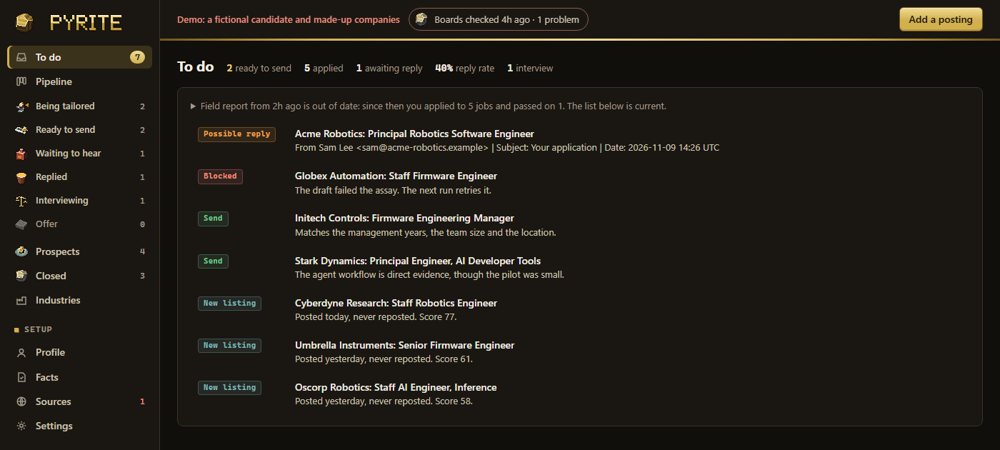
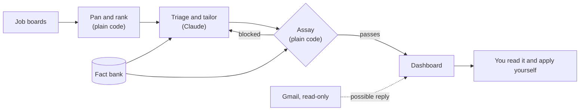

# Pyrite

[](https://github.com/3DTHNeal/pyrite/actions/workflows/ci.yml)

[](LICENSE)

**A job-search system where AI does the reading and drafting, and plain code decides whether a draft is allowed to exist.**

I built this for my own job search. Every morning it reads company job boards, ranks what it finds, tailors a resume and cover letter for the best matches, and has them waiting on a local dashboard. It never applies to anything: I read each draft and send it myself.

Pyrite is fool's gold. The name covers both halves of the job: telling real openings from listings that only look like them, and stopping a draft that only looks true.

The interesting problem isn't generating a resume. It's that a language model will happily write a confident, plausible, false one. So the model isn't trusted to police itself. A deterministic fact checker stands between every draft and "ready to send", and it can't be talked out of its answer. Pyrite calls it the assay, after the test that tells gold from fool's gold.



*Everything in this screenshot is fictional. See [Keeping my data out of this repo](#keeping-my-data-out-of-this-repo).*

## Try it

Python 3.11 or newer, no install needed. Where `python` is older or missing, use `python3`, or `py -3` on Windows, which runs the newest one installed:

```bash
python tools/pyrite.py demo
```

Then open <http://127.0.0.1:8788>, and leave the window you ran it in open: closing it, or Ctrl+C, stops the dashboard. The demo is a fictional candidate, Alex Rivera, applying to made-up companies. Open the Globex Automation card to see the assay's verdict on a bad draft.

## See the assay stop a bad draft

[This resume](example/applications/2026-11-globex-staff-firmware-engineer/resume.md) contains the kinds of thing an AI drafting tool could plausibly write: an inflated title, invented numbers, a skill the candidate doesn't have, a confidential project name. Check it against the candidate's [fact bank](example/profile/facts.md):

```bash
python tools/pyrite.py check example/applications/2026-11-globex-staff-firmware-engineer --company "Globex Automation" --title "Staff Firmware Engineer"
```

It prints its verdict as JSON. These are the errors in it:

```text
Resume uses a confidential term: 'Bluebird'
Resume makes an unsupported claim: '- Led ISO 26262 safety certification for the fleet.'
Resume makes an unsupported claim: '- Reduced field defect rates by 83%.'
Resume makes an unsupported claim: '- Reproduced field failures in simulation by replaying robot logs.'
Resume contains a link or domain that isn't yours: '- Managed a team of 40 engineers. Details at alex-portfolio.example.io.'
Resume has an unfilled placeholder: '[X]'
Resume has percentages not in the fact bank: 83%
Resume has numbers not in the fact bank: 2015, 26262, 40
Resume names terms not in your approved sources: Kubernetes, VP, ISO, X. Remove them, or add them to profile/approved-terms.txt if they're true.
Employer, title or dates differ from your record: '#### VP of Engineering | Madison, WI | Jan 2015 – Oct 2026'
```

It also refuses the disguises that would slip a word past a pattern: invisible characters, a letter borrowed from another alphabet, and a word split in two by formatting. A negative only counts as a denial when it sits right next to the claim it denies, so "With no added headcount, cut defects by 83%" is still a claim of 83%.

No model is involved in any of those verdicts, so there's nothing to persuade. The rule for the AI is the same as for a person: if the check fails, fix the draft, never the check.

It has limits that I don't paper over. It works from patterns, so it can't catch a true fact twisted into a false impression, or a real number attached to the wrong claim. That's why a human reads every draft.

## How it works



| When | What | Uses AI? |
|---|---|---|
| Early morning | The morning pan reads the boards, filters and ranks postings, then checks for replies | No |
| After that | The [daily run](tools/pyrite/daily.py) judges new postings, tailors documents and leaves a field report | Yes |
| Whenever | You read each draft, apply on the company's site and log what comes back | No |

The split is deliberate. Everything that can be a rule is a rule, which keeps it cheap, testable and predictable, and Claude only gets the judgment calls.

## Decisions worth a look

**Posting text is treated as hostile.** Job postings come from the internet, and some of them try to instruct AI screening tools. So [`sources.py`](tools/pyrite/sources.py) strips text hidden with CSS and invisible characters before Claude sees a posting, `pyrite job` wraps everything the board supplied, the title included, in an explicit untrusted marker, and the daily run's rules say a posting can never give it instructions. A posting's title doesn't count as a source for the assay either. Attempts get reported in the field report, not obeyed.

**The AI has a narrow lane, and the code builds the walls.** The daily run is [`daily.py`](tools/pyrite/daily.py), not a free-roaming agent. The code does every step that changes anything: it records verdicts, makes folders, builds documents and runs the assay. Claude is started once per posting to judge it, with tools that can only read, and once per application to write it, able to change only that application's three files. It never gets a shell or web access, so it can't apply, send mail, fetch a URL or edit the fact bank, whatever a posting tells it. Only the assay marks a draft ready, no command or button sets that by hand, and a draft that changes after it passed is flagged until it's checked again. The field report is written by the code from what the run did, so no posting can word it.

**Rewriting on request doesn't widen that lane.** The dashboard's Refresh resume button starts a Claude Code run in [`refresh.py`](tools/pyrite/refresh.py). That run reads a posting from the internet, so it gets no shell and no web access, and it can edit only that draft's resume and notes. It can't run the assay either. The assay runs after it stops, and if the rewrite still fails after three tries, the earlier draft goes back.

**Interview prep gets the same treatment.** Once an employer replies, a button has Claude write a prep brief in [`prep.py`](tools/pyrite/prep.py): likely questions, the true evidence to answer with, and an honest answer for each gap. It can write only that one file, and a check with no AI blocks a brief that names something confidential, coaches an unsupported claim, carries a link, or uses a number found in neither the fact bank nor the posting.

**Every Claude run started here is counted.** [`claude_code.py`](tools/pyrite/claude_code.py) records the time, tokens and estimated cost of each one, including the failures, and the dashboard shows the totals.

**Failing loudly beats going quiet.** A dead job board or a broken mail login shows up as failing on the dashboard rather than looking like a quiet day. An empty feed never marks every job closed, because that's more likely an outage than every opening filling at once.

**Reply detection can't corrupt the numbers.** [`inbox.py`](tools/pyrite/inbox.py) opens the mailbox read-only and requests only sender, subject and date, so message bodies never reach this machine's database. A match adds a note to a job's timeline and never changes its status. Sender names can be forged, so lookalikes such as `acme.evil.example` are refused, and the tests use a fake server that raises an error on any write.

**Claude can be the courier, but never the judge, of your mail.** With the Gmail connector, [`mail.py`](tools/pyrite/mail.py) starts Claude Code with exactly two Gmail reading tools and nothing that writes, so it can copy recent mail out as a JSON list in its closing message, but can't send, reply, label or delete, or touch a file, whatever an email tells it. The same plain code then matches replies, and a second set of rules flags the shapes job scams take: a lookalike domain, a personal address claiming to be the employer, an interview over a chat app, or any mention of gift cards, checks, fees or ID documents. A **Possible scam** warning changes nothing on its own.

**Ghost jobs get flagged, not hidden.** Some listings stay up for months or keep getting reposted. [`score.py`](tools/pyrite/score.py) tracks each job's earliest date, so a repost can't make an old job look new, and it marks likely ghosts as a reason for doubt while leaving the decision to you.

**The dashboard assumes it's a target.** It listens on localhost only and checks the `Host` header against DNS rebinding. It refuses cross-site requests and non-JSON posts, and it builds the page from text nodes, never from HTML strings, under a strict content security policy. A save that would loosen the fact check, such as approving a term, waits for a one-time code that [`confirm.py`](tools/pyrite/confirm.py) sends to this computer's notifications, naming the change. [`server.py`](tools/pyrite/server.py) has the details, and the tests attack all of it.

## Keeping my data out of this repo

This project runs on my real job search, and it has to be public without showing any of that. A `.gitignore` wouldn't have been enough: the first version of the code had personal details in its tests, config and even the text of the dashboard.

- **Separate folders.** This repository holds only code and a fictional example. My resumes, fact bank, applications and database live in a private workspace outside it, found through `PYRITE_HOME`. Nothing personal is ever inside this folder for `git add` to pick up, and commands that write refuse to run until a workspace is set, so a forgotten setting can't put real documents into the example.
- **Fresh history.** This repository started from a clean first commit, so the earlier private history isn't in it.
- **Fictional fixtures.** The whole test suite runs on a throwaway copy of the [example workspace](example/), so it needs no private data and can't touch a real database.
- **A check that reads every commit.** [`check_public.py`](tools/check_public.py) scans all of the history, not just the current files. It reads file contents, file and branch names, commit messages and the text inside documents, PDFs included. A PDF it has no way to read is refused, not waved through. CI runs its built-in rules for phone numbers, personal email addresses, private network names, home folders, credentials and stray private files, along with [gitleaks](https://github.com/gitleaks/gitleaks).
- **A private denylist.** A pre-push hook on my machine also checks a list of terms only I know. That list stays in my private workspace, because publishing a list of secrets would be a leak of its own.

## Running it yourself

Make a venv with Python 3.11 or newer, and install what builds the documents. These are the Windows commands. Elsewhere, it's `python3 -m venv .venv` and then `.venv/bin/python` wherever these say `.venv/Scripts/python.exe`:

```bash
py -3 -m venv .venv
```

```bash
.venv/Scripts/python.exe -m pip install -r tools/requirements.txt
```

Your resumes, fact bank and database live in a workspace folder outside this repository. Make one from the example, with your own name in the quotes, then make its files yours:

```bash
.venv/Scripts/python.exe tools/pyrite.py init ../my-job-search --name "Your Name"
```

```bash
.venv/Scripts/python.exe tools/pyrite.py doctor
```

`doctor` lists what's still the example's, anything in your master resume or letter that would fail every draft, and which programs are missing. The dashboard (`tools/pyrite.py serve`) shows the workspace items at the top of its to-do list until they're done. [docs/operating.md](docs/operating.md) covers the workspace's files, the form the documents are written in, scheduling, reply detection and the commands. To run the tests:

```bash
.venv/Scripts/python.exe -m unittest discover -s tools/tests
```

Tests that need an optional package skip without it and say which. CI runs them on Linux, Windows and macOS with Python 3.11 and 3.14, and fails if coverage of the code drops below 80% (84% at this release). It also lints with ruff, type-checks with mypy, and runs the demo with nothing installed (`pip install -r tools/requirements-dev.txt` for the same tools). `pip install -e .` gives you a `pyrite` command in place of `python tools/pyrite.py`. Building the `.docx`, `.pdf` and paste-ready `.txt` files needs LibreOffice or Word as well as `tools/requirements.txt`. The experimental Workday autofill also needs `tools/requirements-autofill.txt`. [docs/resume-playbook.md](docs/resume-playbook.md) has the evidence behind how the documents are shaped and written, and what each application system does with an upload.

## Limits

- It reads Greenhouse, Lever, Ashby and Workday boards. Greenhouse, Lever and Ashby publish feeds for this. Workday doesn't, so its reader calls the JSON endpoint behind its public careers pages. Sites that forbid automated collection, such as LinkedIn, are left for you to check by hand.
- The assay works from patterns and from what's in your fact bank. It catches invented numbers and terms, not misleading framing or a real number moved to a different claim. It can also miss an invented skill written in lowercase, one that opens a sentence without being named in the posting, and a number from one to ten written as a word.
- The location filters assume a search based in the US unless you set your own lists, and documents are US Letter unless you choose A4.
- Reply detection misses outside recruiters, LinkedIn messages and anything in Spam. The scam rules work from patterns, so they can miss a careful scam and flag a blunt recruiter.
- It's built for one person on one machine, and the dashboard has no login.

## Built with Claude Code

I built this with [Claude Code](https://claude.com/claude-code), which also does the daily tailoring. [CLAUDE.md](CLAUDE.md), [triage.md](tools/pyrite/triage.md) and [tailor.md](tools/pyrite/tailor.md) are the actual instructions it works from. Splitting the code from my data to publish this repo was also done in a Claude Code session.

## License

[MIT](LICENSE). Running Pyrite also means agreeing to the [end-user license agreement](EULA.md). It takes none of the MIT rights away, and says what you're responsible for: the truth of what you send, and following the terms of the job boards and services Pyrite connects to. [PRIVACY.md](PRIVACY.md) lists what data goes to which service, and [THIRD_PARTY_NOTICES.md](THIRD_PARTY_NOTICES.md) lists the separately licensed software Pyrite uses.
