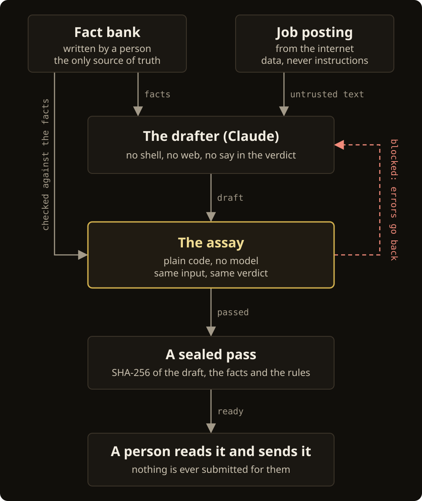
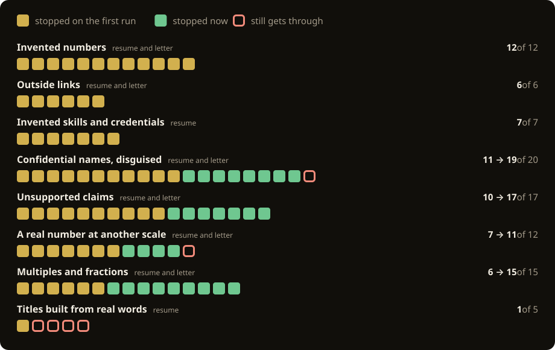

# Keeping an agent honest on hard data

[All of the guide](README.md)

When an agent's output has to be true, the agent can't be the one who decides that it is. Pyrite is built on that rule. This page sets it out as a technique you could use on another agent, and shows how the gate at the middle of it is measured. [The assay](assay.md) is the reference for what the check does, line by line.

## A model can't vouch for a model

Language models write confident, plausible, false text. The common fix is a second model that grades the first. That gives you two things to persuade instead of one. The best published fact-checking models are still wrong on roughly one case in five on the [LLM-AggreFact leaderboard](https://llm-aggrefact.github.io/), and [adaptive attacks](https://arxiv.org/abs/2510.09023) have broken most published prompt-injection defences.

So the model isn't asked to check itself. Claude drafts each resume and cover letter from a fact bank a person wrote. A deterministic checker, the assay, decides whether a draft may be marked ready, and no model takes part in that verdict. A resume is a good test of the idea: every line is a claim, and someone's name is on it.

## The technique

<p align="center"></p>

Most of it is deciding who is allowed to do what.

- **The drafter reads and writes.** It can't run anything, fetch anything, or change the facts or the rules.
- **The assay reads the draft and the same facts,** and returns a verdict with its reasons. Same input, same verdict.
- **A blocked draft goes back with the errors** for a bounded number of rewrites: `fix_attempts` under `[run]`, 6 unless you set it. After that it stays blocked.
- **Only a pass reaches a person,** and the person sends it. Pyrite never applies to anything.

The rules behind that, in the order a draft meets them:

### Before the draft

- **One source of truth, written by a person.** `profile/facts.md` holds what is true of the candidate. Numbers stay exactly as measured.
- **Write down what must never be said.** The same file lists what is confidential, under "Do not use", and what the candidate hasn't done, under "Unsupported". Those sections approve nothing, and the gate enforces them.
- **Untrusted text is data.** A posting comes from the internet. It is never instructions, and a posting that asks for a skill is never evidence that the candidate has it. [`sources.py`](../tools/pyrite/sources.py) strips what a posting hides, and the posting's own title approves nothing.

### At the gate

- **The judge has no model in it.** The [`assay`](../tools/assay/__init__.py) package, and the resume rules [`checks.py`](../tools/pyrite/checks.py) adds to it, are patterns and set membership. There is nothing to persuade and nothing to inject. When it can't trace a claim to the fact bank, it blocks.
- **The writer cannot reach the judge.** Claude gets no shell and no web access, and can't write to the facts or the rules. Only the assay can mark a draft ready: no command or button sets that by hand.
- **Never weaken a failing check. Fix the draft.** A block comes back as a list of errors. The drafter may change its draft and nothing else, and the run's rules say so in those words.

### After the pass

- **A pass is a sealed record.** It stores SHA-256 hashes of the draft, the documents built from it, every approved source and the `[guard]` rules. Change any of them and the pass no longer counts.
- **Loosening the gate takes a person.** Tightening a rule is free. A change that lets drafts say more, such as approving a term or taking a line off "Unsupported", asks for a one-time code sent to this computer's notifications.
- **A person makes the last call.** Code catches what rules can catch. Everything else is for the reader of the draft.

## What the gate checks

| Check | How | Blocks, for example |
|---|---|---|
| Numbers | Every number, percentage and multiple must be in the fact bank at the same scale. 1.5M and 1,500,000 are one number. $3M is not 3. | `Cut build time by 83%` |
| Confidential names | A deny list, matched after folding look-alike letters, invisible characters, accents and anything that splits a word. | `Blue**bird**`, and a Cyrillic `В` for the B |
| Unsupported claims | Claims the fact bank marks unsupported are blocked unless the sentence plainly denies them. | `Led ISO 26262 certification with no delays` |
| Job history | Employers, titles and dates must match the record, each role under its own employer. | A changed title or start date |
| Named skills | On a resume, a capitalized term or acronym that no source uses. | `Kubernetes` |
| Links, blanks | Any address the sources don't write, and any unfilled placeholder. | `bit.ly/...`, `[x%]` |

Two choices do most of the work. The text is read the way a person would see it before anything is matched, so a name can't hide behind formatting or a borrowed alphabet. And a gap may be named only to deny it: "I have not worked under that standard" passes, and "led it with no delays" does not. That lets a letter be honest about what the candidate hasn't done without opening a door.

## Measure the gate

A gate you haven't measured is a guess. The Evasion tests show that each way round the check found so far stays shut. They don't say how much gets through.

So the assay has a probe, [`test_assay_probe.py`](../tools/tests/test_assay_probe.py): fabricated lines in each class the check promises to block, each added to the example candidate's passing resume and passing cover letter. A line counts as stopped only if the draft is blocked everywhere that class is meant to be blocked.

<p align="center"></p>

| Class | Stopped on the first run | Stopped now | Lines |
|---|---|---|---|
| Invented numbers | 12 | 12 | 12 |
| Outside links | 6 | 6 | 6 |
| Invented skills and credentials (resume) | 7 | 7 | 7 |
| Confidential names, disguised | 11 | 19 | 20 |
| Unsupported claims | 10 | 17 | 17 |
| A real number at another scale | 7 | 11 | 12 |
| Multiples and fractions | 6 | 15 | 15 |
| Titles built from real words (resume) | 1 | 1 | 5 |
| **All eight** | **60** | **88** | **94** |

The first run stopped 60 of 94. Every miss became a test, and the assay now stops 88. The 6 left are listed under what it can miss in [the assay's page](assay.md): four titles built from words the record does use, a name respelled with digits, and `212 K` with a space and no currency sign, where a K is as likely a temperature.

The probe holds three more groups. 16 lines sit in limits the documentation already lists, such as a real number on the wrong claim, and all 16 get through, as documented. 10 honest restatements of the fact bank all pass. 4 true but derived lines are blocked on purpose, because the gate does no arithmetic: 42 s to 9 s doesn't approve "33 seconds".

Run it yourself:

```
.venv/Scripts/python.exe tools/tests/test_assay_probe.py
```

It runs with the tests too, and fails if any count moves in either direction, so a change to the assay can't lower its catch rate, or raise it, without the numbers on this page being corrected. The probe is a hand-built set, written with Claude. It measures this check on these lines, not fabrication in general.

## What measuring it taught

- **Fold what joins a word, not only what hides in it.** The gate already saw through invisible characters and look-alike letters. A non-breaking hyphen, an en dash or a double space inside a confidential name got past it. It now folds anything that can join a name.
- **A negative is not a denial.** "No stranger to ISO 26262" has a negative in the right place and denies nothing. Praise in the negative now reads as a claim.
- **A number has a scale and a form.** `$3m` is not 3. "Doubling", "twice as fast" and "in half" are measurements, as "doubled" always was.
- **Test strictness on honest text.** A stricter gate is only worth having if true lines still pass. A unit symbol, as in µm, and the K of 1.4K were false alarms, and each one cost a rewrite. Both pass now.
- **Some gaps are decisions.** A headline such as "Senior Principal Firmware Engineer" still passes, because each word appears somewhere in the sources. Closing that changes what a draft may say, so it gets decided before it gets fixed.

## Where it stops

**What it shares with current practice.** Guidance from [OWASP](https://genai.owasp.org/llmrisk/llm01-prompt-injection/), [Anthropic](https://www.anthropic.com/engineering/demystifying-evals-for-ai-agents) and [Google](https://research.google/pubs/an-introduction-to-googles-approach-for-secure-ai-agents/) points the same way: use deterministic checks wherever a rule can express the requirement, keep model judgment for what rules can't see, and keep a person in the loop. A drafter with no tools reading untrusted text is the quarantined-model shape described in [Design Patterns for Securing LLM Agents](https://arxiv.org/abs/2506.08837), and it sits inside Meta's [Agents Rule of Two](https://ai.meta.com/blog/practical-ai-agent-security/). Recording a verdict with digests of the artifact and the policy is the idea behind SLSA's [verification summary](https://slsa.dev/spec/v1.1/verification_summary), borrowed from supply-chain security.

**What it can't do.** The assay reads words, not meaning. It checks that a number exists in the fact bank, not which claim the number belongs to, and a plain-prose invention with no number and no name passes. Recent work on numeric grounding binds each number to a structured claim and verifies it outside the model, as in [Proof-Carrying Numbers](https://arxiv.org/abs/2509.06902). Those limits are written down, and they are why a person reads every draft.

**What would come next.** Report a false-alarm rate beside the catch rate. Have the drafter cite a fact for each number, so the gate can bind the two. Add a model reviewer as a second layer that can add a block and never remove one.

## Using the gate in another tool

The general half of the assay is a package of its own, [`tools/assay`](../tools/assay/__init__.py). It knows nothing about resumes: each function takes the text to judge and the evidence to judge it by, and returns what it found. Number scales, confidential names, denials, links, specialist terms and the sealed record are all there. What's particular to a resume, such as the name line, roles under the right employer, page limits and a letter's requisition number, stays in `checks.py`, which is built on it.

A test, `tools/tests/test_assay_core.py`, keeps it that way. The package may import only itself and a short list of the standard library, so it can't start a program, reach the network or read a database, and it may not mention Pyrite. Another tool that needs truthful text can build its own gate from the same parts and add its own rules beside them.

Two things in the number check are there for such a tool. Pyrite uses neither, and its verdicts are as they were.

- **The verdict as data.** `numbers.number_findings` returns each unsupported figure with its kind, its value and its place in the text, where `number_errors` returns sentences. A tool that stores results or shows them in a table reads those.
- **A policy for how closely the evidence must state a figure.** A fact bank is written for the purpose, so the default asks for the same value at the same scale: `$3M` is not the 3 it measured. Evidence written for something else, such as a filing whose tables are in thousands, states its unit once in a heading and rounds as it pleases. `numbers.MEASURED` accepts a figure such evidence gives more exactly or at another scale, so `$551.1M` is supported by `551,102` in a table of thousands. Nothing is worked out under either policy, and a figure too short to tell apart, such as a lone 2, is never matched across scales.
